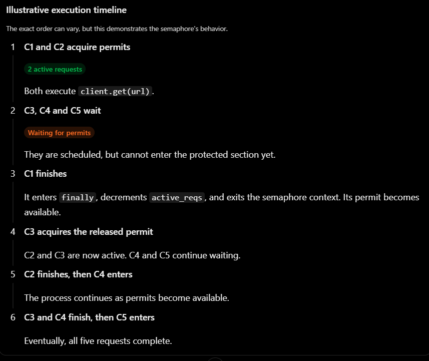
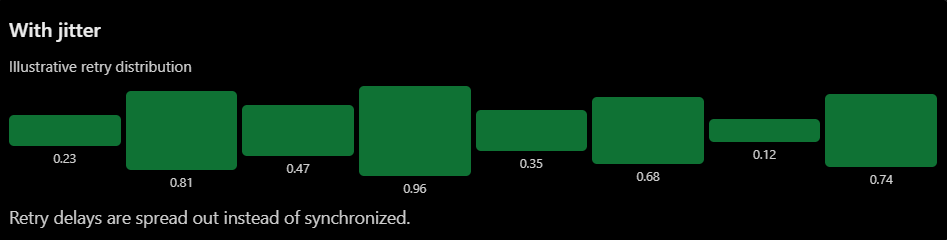

# Production Grade Asynchronous crawler

## Semaphore commit reference (analyzing coroutine sequence)

### reference output testing out semaphore permits for coroutines
```
--bash--
(.venv) PS E:\projects\prod-async-fetcher> python src/prod_async_fetcher/main.py
maximum reqs at this point:  2
maximum reqs at this point:  2
maximum reqs at this point:  2
maximum reqs at this point:  2
maximum reqs at this point:  2
responses:  [<Response [200 OK]>, <Response [200 OK]>, <Response [200 OK]>, <Response [403 Forbidden]>, <Response [301 Moved Permanently]>]
Close inside context:  False
closed after context:  True
fetcher client after context:  None
```

## jitter (contolling the thunder herd problem)
### jitter illustration 


## A pretentious abstraction of code (not needed)
- the existing context manager already gives us the chance to release the semaphore
- async context manager protocol guarantees that the semaphore's __aexit__ runs when execution leaves the block, including when an exception occurs.
```
async with self.semaphore:
    res = await self.client.get(url)

# Semaphore has already been released here.
``` 
which is already conceptually equal to the below
```
await self.semaphore.acquire()

try:
    res = await self.client.get(url)
finally:
    self.semaphore.release()
```
- So, the additional helper with @asynccontextmanager becomes redundant 